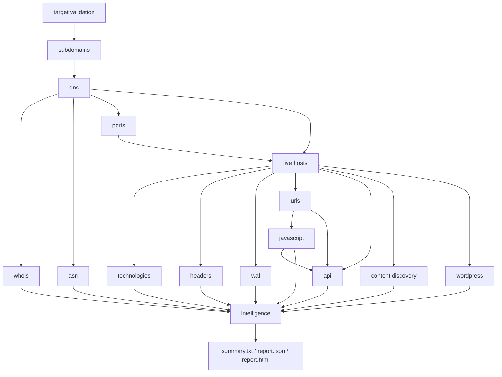

# Architecture

FullRecon is a pipeline of independent modules that share one state object.
Each module reads what earlier stages produced and writes its own results, so
nothing is fetched twice.

## Data flow



## External tool layer

`core/tools.py` wraps every optional binary behind one contract:

```python
result = tools.subfinder(domain)
if result.ok:          # parsed items available
    use(result.items)
else:                  # missing binary, timeout, or non-zero exit
    fall_back_to_native()
```

`ToolResult` records `available`, `ok`, `items`, `error`, `skipped_reason` and
`duration`, so the report can state exactly which coverage came from which tool.
Adapters never raise; a broken binary degrades to the built-in implementation.
Binaries are resolved through `PATH` (never `./tool`) to avoid executing
attacker-planted files in a scan directory.

## Core objects

| Object | Responsibility |
|---|---|
| `Config` (`config.py`) | Every tunable value: defaults plus JSON overrides. |
| `Scope` (`core/scope.py`) | Allow/deny decisions for hosts, URLs, ports, CIDRs and wildcards. |
| `HttpClient` (`core/scanner.py`) | Rate-limited HTTP(S) with retries, redirects, gzip/chunked decoding and per-request scope checks. |
| `PortScanner` (`core/portscan.py`) | nmap integration with service detection, threaded TCP-connect fallback. |
| `OutputManager` (`core/output_manager.py`) | Creates the numbered result tree, refuses silent overwrites, records every file written. |
| `ReconState` (`core/context.py`) | The results of every module, plus counts, errors and timings. |
| `ModuleContext` (`core/context.py`) | The bundle handed to a module: config, scope, HTTP client, output, state, logger. |
| `Orchestrator` (`core/orchestrator.py`) | Module order, passive/active filtering, crash isolation, report trigger. |
| `ReportGenerator` (`core/report_generator.py`) | summary.txt, report.json, report.html, manifest.json. |

## Module contract

```python
class MyModule:
    name = "my_module"      # pipeline key
    label = "My Module"     # shown in the CLI

    def __init__(self, ctx: ModuleContext) -> None:
        ...

    def run(self) -> dict:   # summary counts, shown in the module status table
        ...
```

Rules every module follows:

1. **Scope first.** Call `ctx.in_scope(host)` or `ctx.scope.allows_url(url)`
   before any request that is not a hard-coded passive data source.
2. **Write through the manager.** `ctx.out.write(folder, filename, lines)` keeps
   the manifest and directory policy consistent.
3. **Publish to state.** Put results on `ctx.state` so later modules reuse them
   instead of repeating work.
4. **Never raise for external failure.** Log with `ctx.record_error(...)` and
   return a partial summary.
5. **No exploitation.** Modules observe; they do not attack.

## Concurrency model

- Module-level parallelism uses `ThreadPoolExecutor` bounded by `cfg.threads`.
- HTTP pacing is enforced by `RateLimiter` **per host**, not globally, so many
  subdomains can be probed without hammering any single one.
- `Deduplicator` and `Counter` in `core/deduplication.py` are lock-protected, so
  results merged from worker threads stay consistent.

## Passive vs active

| Mode | Behaviour |
|---|---|
| default | Full pipeline. |
| `--passive` | Modules marked passive-safe only: subdomains (third-party APIs), DNS (public resolvers), intelligence. No packets to the target. |
| `--active` | Skips passive subdomain enumeration; starts from the target and its known hosts. |

The passive flag is declared per module in `PIPELINE`, next to the class, so the
classification cannot drift away from the implementation. `dns` and `live` are
both marked active because they send queries or requests to the target itself.

## Failure handling

- A module exception is caught by the orchestrator, recorded in
  `module_status[key]["detail"]` and in `state.errors`; the pipeline continues.
- Individual HTTP failures are retried `cfg.retries` times, then recorded as an
  empty `Response` with `error` set.
- Every passive source is queried inside a guarded futures call: one dead API
  yields zero results, never an aborted scan.
- Reports are generated even when modules fail, with an "errors and limitations"
  section listing exactly what was skipped.